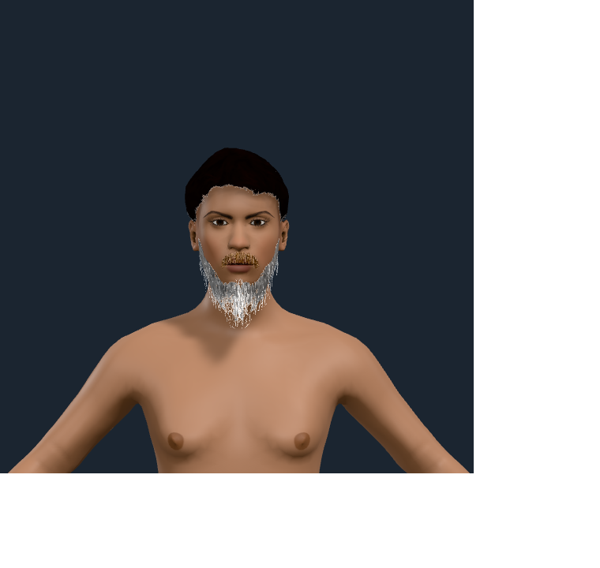
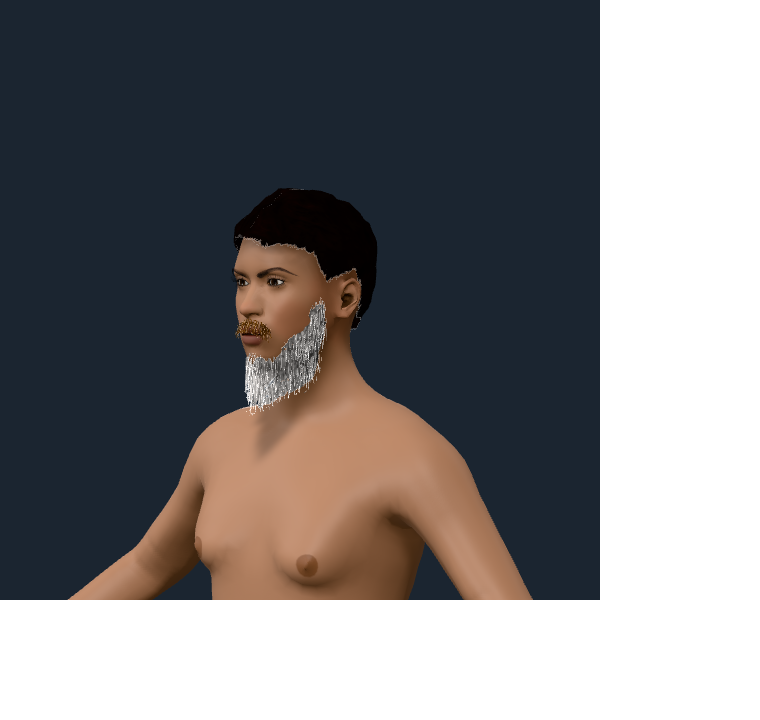
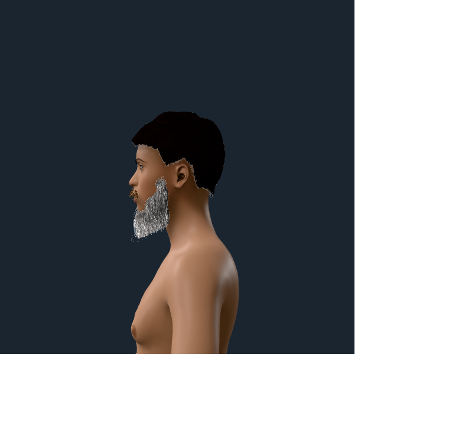
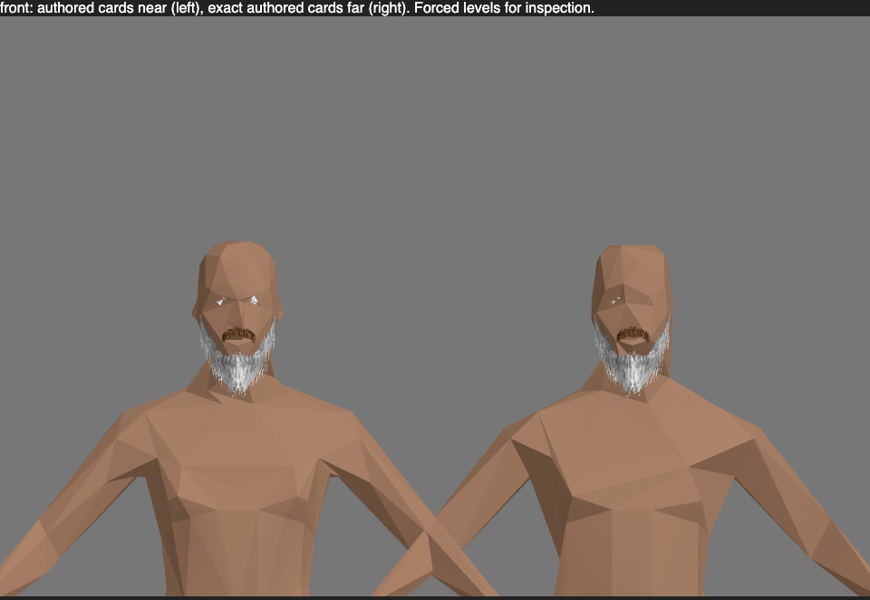

# Independent authored facial colour

Accepted 2026-10-14: bounded independent uniform colour routing for the authored
`beard-viking` and `moustache-viking` source cards. The live figure wears `short02`
at the existing black pigment preset, with the beard at the white preset and
the moustache at the red preset. Brows, lashes and the body coat keep their
existing colour routes. Source geometry, UV seams, textures, alpha and holes
are unchanged.

## Accepted captures









The miniature keeps the existing scalp projection route. These captures do not
assert a new scalp card, solid beard, grey streaks, fork, volume or per-instance
facial recolouring. A changed baked facial colour requires another archetype.

## Producers and checks

The live producer is `tests/browser/facialHairColour.test.tsx`; its camera uses
the actual settled skinned portrait bounds. Its front/oblique/profile PNG
artifacts are requested explicitly with `--mode facial-colour-capture`.
The default route still runs every worker, material, source-buffer and
colour-restoration assertion, without waiting for screenshot transport.
The miniature producer is
`tests/browser/facialHairColourMiniature.test.ts`, with one static frame,
`body: "surface"`, body triangle targets `[800, 400]`,
`facialHair: "alpha-cards"` and `facialHairLod: "all"` on the distant crowd.
Each source image is decoded separately, without changing its pixels.

Both producers ran in silent headless Chromium with the macOS Metal GPU route.
The accepted live run passed one test without errors or skips; the accepted
miniature run passed its test without skips. Focused core validation passed
28 tests. Typecheck, lint, documentation lint, build, package lint, ESM type
resolution and the packed-consumer import check passed.

| Route | Actual fault | RED result | Byte restoration and GREEN result |
| --- | --- | --- | --- |
| Live `Humanoid` facial `HairMesh` | Replace the per-id resolver with the existing global `wornColour` | Actual material tint was black instead of `[1.375, 1.375, 1.375]`; assertion failed | Restore exact source bytes; actual live tint, worker recipe, scalp/brow/lash isolation and unchanged geometry/material identity assertions passed |
| Miniature source card | Resolve colour with an empty override map | Baked card tint was black instead of `[1.375, 1.375, 1.375]`; assertion failed | Restore exact source bytes; per-card colour, source arrays/pixels, format round-trip and unchanged default bytes passed |

Exact restored source SHA-256:

```text
src/react/Humanoid.tsx
  dac73b7567de5b1b69b44db61b0f4f1e44c5adbef23ae7cf617b3b4236dbd401
src/bake/miniature.ts
  cec0d51c3186e8f86a4c3aed62db0d20075f1f5b257ac720628cfe358b974387
```

The encoded native/default miniature SHA-256 was identical with the legacy
colour fault and after restoration:

```text
e03fd6fb6b42ee1a5839752669bf47c00bc155f47ba098eeae3a14060a3b33b8
```

The miniature retains 8,162 facial vertices, 7,046 facial triangles and
7,342,760 bytes of source textures including mipmaps. Near/far totals remain
7,846/7,446 triangles and three draw calls each. Colour overrides add no
geometry or texture resource; they change only each selected card's existing
tint values. This is bounded source-card proof, not a crowd benchmark or a
claim that issue 14's other requirements are complete.

Reproduce the focused routes with:

```sh
pnpm exec vitest run --project unit tests/facialHairColour.test.ts tests/miniatureFacialHair.test.ts tests/hairRecipe.test.ts tests/facialHairRuntime.test.ts
pnpm exec vitest run --project browser tests/browser/facialHairColour.test.tsx tests/browser/facialHairColourMiniature.test.ts
pnpm exec vitest run --mode facial-colour-capture --project browser tests/browser/facialHairColour.test.tsx
```
