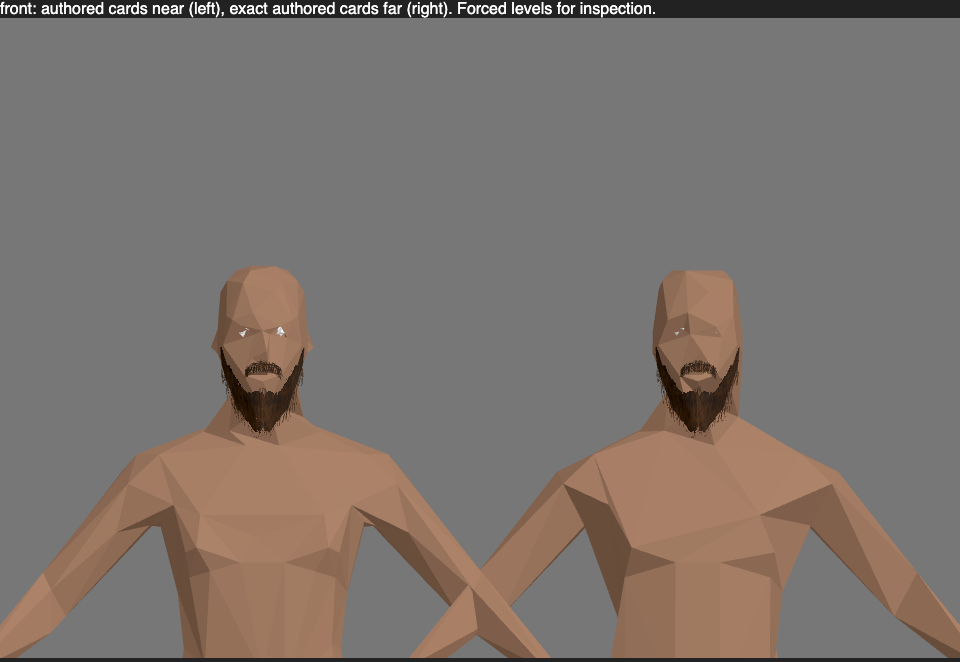
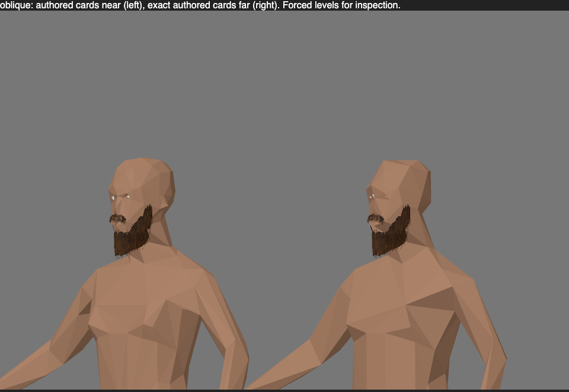
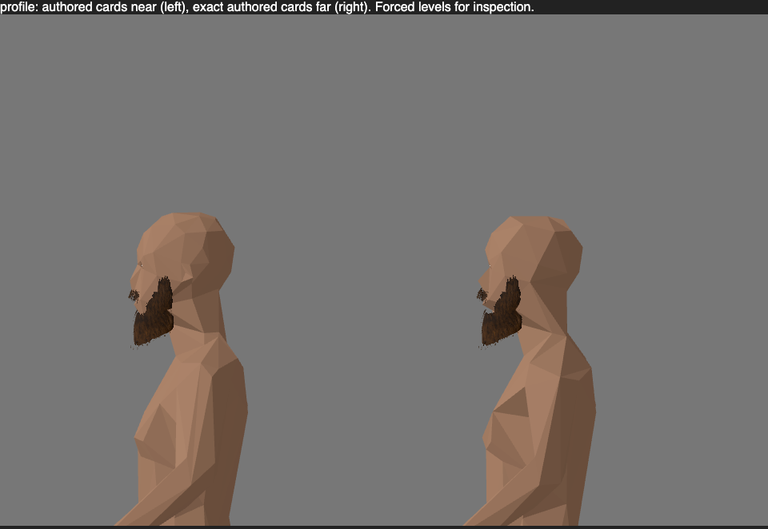
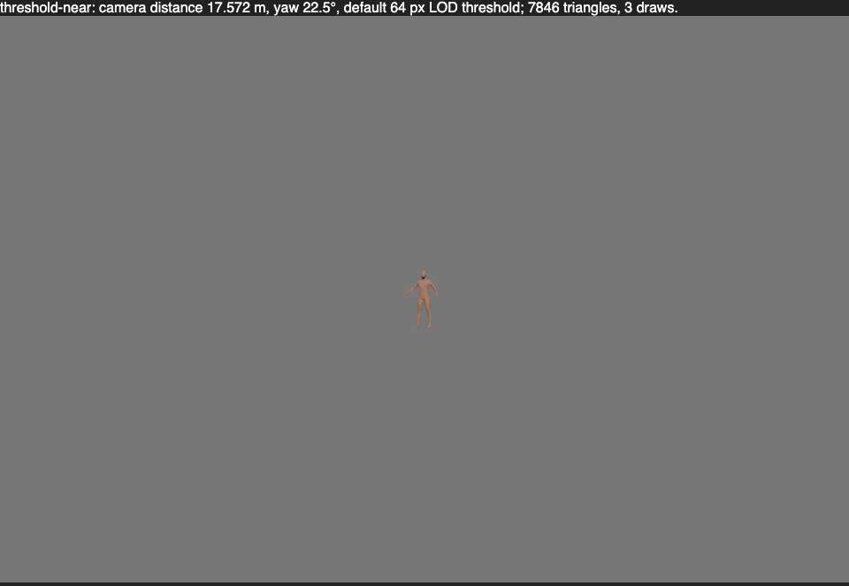
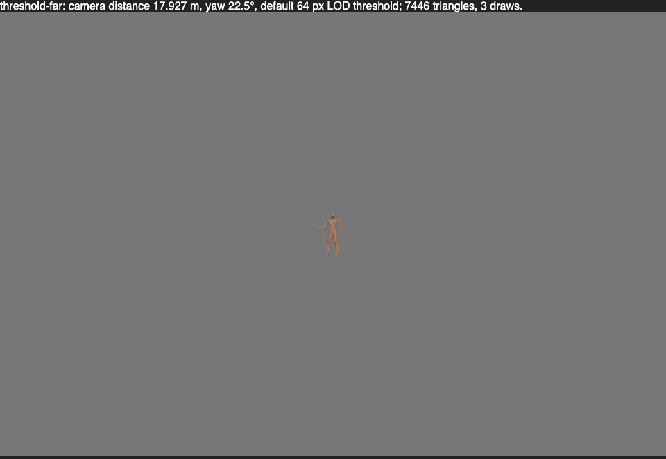

# Authored facial cards at every miniature body LOD

`facialHairLod: "all"` retains the existing baked source cards at every body
LOD. The default stays `"near-only"`. This changes renderer selection and
budget accounting; it adds no bake fields, geometry, maps or animation data.
Cards use the existing VAT frame interpolation, clip timing, source alpha,
filtering, tint and rasterizer coverage. It does not simplify facial geometry.

## Evidence

Headless Chromium with Metal on the shared render host, 2026-10-14:
`render-506ad46aaca84f08aff33d6df0078d16`. Two native source captures and one
600-figure comparison passed. Captures use the packed authored beard and
moustache, decoded through Canvas; both paths share those same decoded pixels.
Canvas's transparent-RGB limitation is described in [MINIATURES](../MINIATURES.md).

Left: default near cards with an 800-triangle body. Right: all-LOD cards with
an independently decimated 400-triangle body. The body's silhouette and
occlusion therefore differ; the source cards remain the same.

The native-size captures immediately around the 64-pixel LOD threshold retain
the cards. They are visual evidence, not a claim that the body LOD is continuous.

## Measured costs

The 600-figure comparison uses the same 400-triangle body, 960 × 640 viewport,
eight headings and multisampling in both paths. All 600 figures are visible.
Forced level zero is the source-card reference; forced level one uses `"all"`.

| Path | Triangles | Draws | Retained texture bytes | GPU batch means, ms |
| --- | ---: | ---: | ---: | --- |
| Body only | 240,000 | 1 | 24,576 | 0.134 / 0.141 / 0.233 |
| Source cards, level zero | 3,649,200 | 2 | 5,879,124 | 1.284 / 0.641 / 0.673 |
| Source cards, level one | 3,649,200 | 2 | 5,879,124 | 0.696 / 0.945 / 1.055 |

Both source paths produced byte-identical images. Relative to the body-only
image, each had 740 affected pixels at an RGB-sum difference above 15, with
zero unmatched pixels and zero mean RGB difference. Separate 50-update CPU
means were 0.388 ms and 0.410 ms. GPU times use three five-render timer-query
batches after eight warmup renders. Shared-host variation is visible; these
are bounded measurements, not FPS or performance-improvement claims.

Texture bytes count retained allocations including source map mipmaps and VAT
padding, not queried driver residency or total GPU process memory. One static
beard has 5,682 source triangles; adding the moustache yields 7,046. A single
far body plus both cards therefore draws 7,446 triangles in three calls and
retains 7,342,760 texture bytes. The renderer option adds zero texture bytes.
Animated bakes retain their existing per-frame VAT costs.

GPU job `render-02f82cc0064c4c1db4480fd19d4d901c` passed six tests, including
React option changes. A synthetic GPU test compares every pixel across two baked frames,
intermediate time, clip phase/speed and a four-sample target. It proves that
the all-LOD selection keeps that baked animation and coverage. It does not
establish native posed collision, dynamic growth or a solid facial-hair model.
