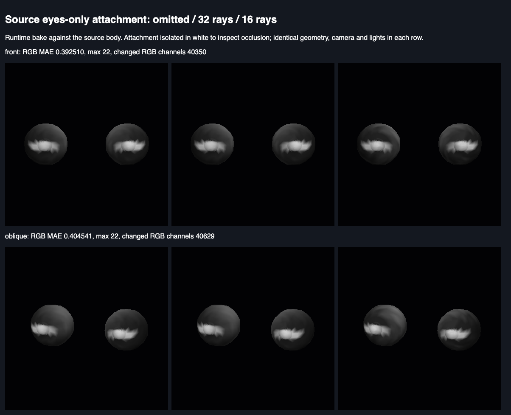

# Runtime attachment occlusion quality through the renderer

Measured on 2026-10-14 against source base `9b9fbcb3`, with the existing
`ModelOptions.runtimeOcclusionRays` API. This adds a renderer proof for the
runtime custom-set bake; it changes no model, material, pack or quality default.

## Actual bake and source geometry

`tests/browser/runtimeOcclusionQuality.test.ts` loads the body pack and wears
only `eyes/high-poly`, a set the pack did not bake together. It verifies that
`occlusionBakeRecipe()` requests a runtime bake. The packed occlusion bytes
remain present and unchanged. Three models use omitted, explicit 32 and
explicit 16 rays, all at subdivision 0. Their evaluated eye positions, normals
and triangle indices are identical. The omitted and 32-ray fields are
byte-identical. The 16-ray field differs at 5,616 of 8,608 corner components:
MAE 0.0342123606, maximum absolute difference 0.1875.

One geometry object holds the 1,076 source render vertices, without alteration.
Every draw uses the same `AttachmentStandardMaterial`, camera and lighting;
only `setOcclusionAttributes` receives a different model's actual runtime field.
Snapshots verify that positions, normals, indices and packed occlusion bytes
remain unchanged after rendering. An all-open diagnostic additionally proves
that the material consumes occlusion attributes.

## Rendered pixels

Muted headless Chromium ran on a macOS runner with an Apple GPU. The browser reports
`ANGLE (Apple, ANGLE Metal Renderer: Apple M2 Max, Unspecified Version)`.
The attachment is isolated in white to make the field observable; this is a
material diagnostic rather than a textured whole-figure acceptance view.

Each 384×384 view compares three frozen render-target readbacks, ordered
omitted / explicit 32 / explicit 16. Omitted and explicit 32 produce identical
RGBA bytes in both views. RGB differences below exclude alpha and average
across the full image, including its background.

| View | 16 vs 32 RGB MAE, 8-bit units | Maximum channel difference | Changed RGB channels |
| --- | ---: | ---: | ---: |
| Front | 0.3925103082 | 22 | 40,350 |
| Oblique | 0.4045410156 | 22 | 40,629 |

These field and image differences establish a quality tradeoff and actual
renderer consumption. They establish no CPU timing or GPU speedup. The
option changes runtime bake work, not shader ray counts. This bounded source
sample does not recommend 16 rays for every custom attachment set or pose.

## Producer controls and restoration

Two temporary source faults ran against the unchanged test:

- Forcing `HumanoidModel.bakeOcclusionAt` to pass `rays: 32` failed with
  `ray option must affect a real custom bake: expected 0 to be greater than 0`.
- Removing `AttachmentStandardMaterial`'s `patchOcclusion` call left the CPU
  fields different, but failed with
  `front: renderer must consume the changed bake: expected 0 to be greater than 0`.

Both files were restored byte for byte. The restored test and the existing
`tests/browser/occlusion.test.ts` passed all three checks, with no skips.
Source hashes, exact job identities, GPU string, image hash and numerical
readbacks are in [the receipt](runtime-occlusion-quality.receipt.json).

## Scoped gates

The focused browser checks, Biome, markdown lint, typecheck, build and package
checks pass.
This evidence adds no pack validation or regeneration, full coverage verdict,
whole-figure acceptance, publication or board closure.
